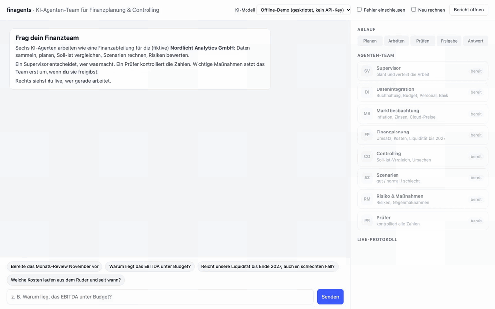
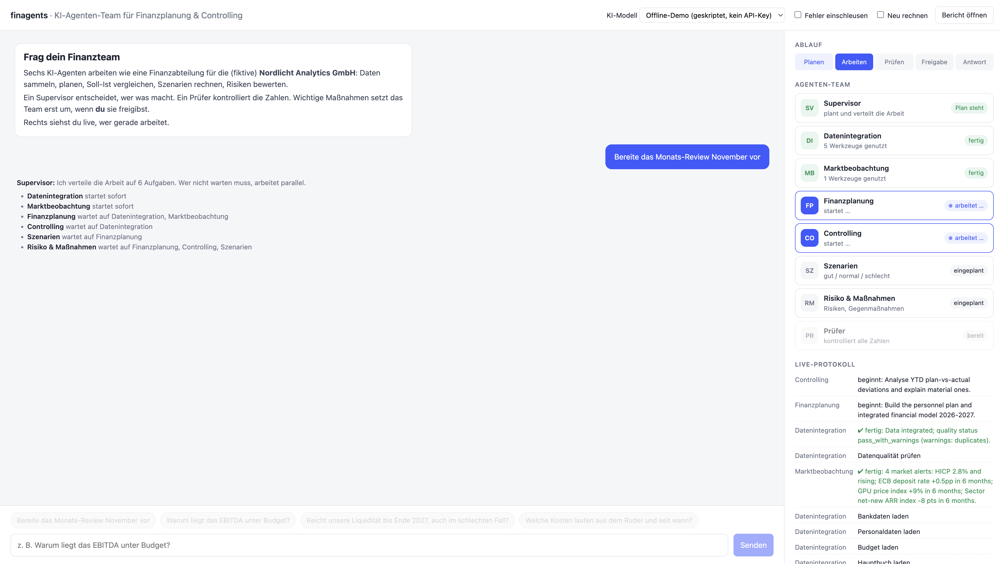
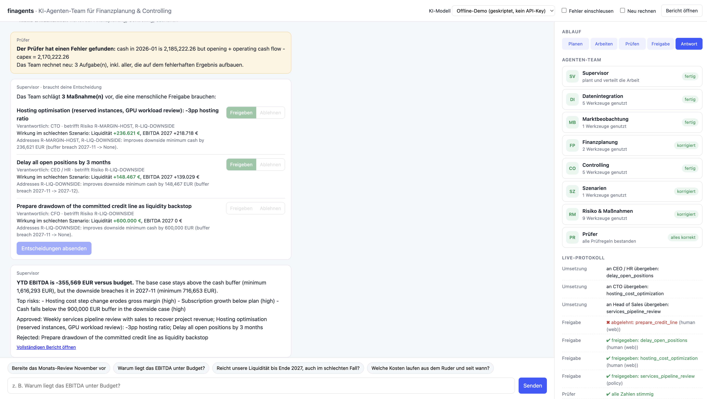
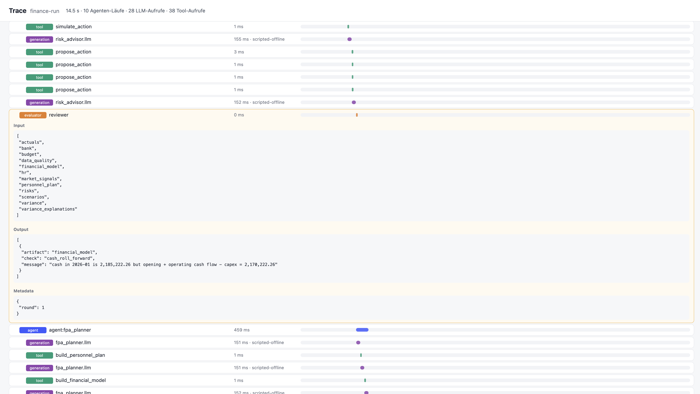

# finagents: KI-Agenten-Team für Finanzplanung und Controlling

Referenzimplementierung einer universellen Multi-Agent-Architektur (Python, LangGraph).

**Video in voller Qualität:** [demo.mp4](demo.mp4) · **Architektur & Designentscheidungen:** [finagents-architektur.pdf](finagents-architektur.pdf)

## Worum es geht

Ein Supervisor-Agent zerlegt einen Auftrag, z. B. „Bereite das Monats-Review vor“, in einen Aufgaben-Graphen und
verteilt die Aufgaben an sechs spezialisierte Agenten, die parallel arbeiten:

| Agent | Aufgabe |
|---|---|
| Datenintegration | Hauptbuch, Budget, HR, Bank und Marktdaten laden; Datenqualität prüfen |
| Marktbeobachtung | Inflation, Zinsen, Cloud-Preise, Branchennachfrage → Warnsignale und Planungstreiber |
| Finanzplanung | Personalplan und integriertes Finanzmodell (GuV, Working Capital, Liquidität) |
| Controlling | Soll-Ist-Vergleich mit Ursachenanalyse (seit wann, Einmaleffekt oder dauerhaft, welche Kostenstelle) |
| Szenarien | Forecast und Szenarien bis Ende 2027, Liquiditätsreichweite |
| Risiko & Maßnahmen | Risikoregister mit Belegen, im Modell simulierte Maßnahmen mit Wirkung in € |

Ein **unabhängiger Prüfschritt** kontrolliert die Ergebnisse und schickt fehlerhafte Arbeit an den Verursacher und
alle abhängigen Aufgaben zurück. Maßnahmen mit Tragweite legt das System einem **Menschen zur Freigabe** vor. Erst
danach werden sie ausgeführt. Über den Chat lassen sich anschließend Folgefragen stellen.

## Zentrale Designentscheidungen

- **Universeller Kern:** Planung, Orchestrierung, Prüfung, Nacharbeit und Freigabe sind domänenunabhängig. Finanzen
  sind ein austauschbares Modul, weitere Prozesse wie Rechnungseingang, Einkauf oder Vertrieb nutzen denselben Kern.
- **Das Modell entscheidet, Code rechnet:** Sprachmodelle wählen Werkzeuge und interpretieren Ergebnisse. Alle Zahlen
  kommen aus einem deterministischen Rechenwerk und sind dadurch widerspruchsfrei.
- **Kontrollierte Autonomie:** Agenten können Aktionen nur vorschlagen. Ob ein Mensch freigeben muss, entscheidet
  eine Regel im Code, nicht das Modell.
- **Testbar:** Ein deterministischer Modus ersetzt das Sprachmodell, so läuft das Gesamtsystem ohne Token-Kosten in der CI.

## Observability, Evaluierung, Integration

- **Tracing mit Langfuse:** Jeder Lauf ist ein Trace mit Planung, Agenten, Modellaufrufen (inkl. Token-Verbrauch),
  Werkzeugaufrufen, Prüfrunden, Freigabe und ausgeführten Maßnahmen. Ohne Langfuse zeigt eine lokale Trace-Ansicht
  denselben Baum.
- **LLM-Evaluierung als CI-Gate:** Feste Testfälle prüfen u. a., ob die richtigen Agenten geplant wurden, ob der Prüfer
  einen eingeschleusten Fehler findet, ob abgelehnte Maßnahmen wirklich nicht ausgeführt werden und ob jede Zahl in
  der Antwort aus den Daten stammt. Optional bewertet zusätzlich ein Modell die Antwort (LLM-as-Judge). Schlägt ein
  Fall fehl, blockiert die Pipeline.
- **AG-UI-Protokoll:** Das Agenten-Team ist als AG-UI-Agent ansprechbar: Agenten erscheinen als Subagents,
  Werkzeugaufrufe und Status werden live gestreamt, die menschliche Freigabe läuft über den Interrupt/Resume-Ablauf
  des Protokolls.
- **PostgreSQL:** Zustände, Läufe, Entscheidungen und Evaluierungsergebnisse liegen in Postgres. Eine offene Freigabe
  übersteht einen Neustart des Servers.

## Screenshots

---

Sarah Koch · © 2026 Sarah Koch. Alle Rechte vorbehalten.
